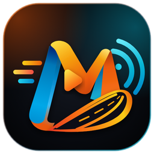
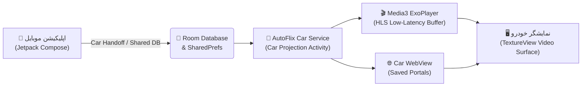

<div align="center">



# 🎬 AutoFlix | آتوفلیکس

**پلتفرم هوشمند پخش زنده تلویزیون، مالتی‌مدیا و مرورگر وب برای اندروید و نمایشگر خودرو (Android Auto)**

[](https://github.com/mostafa5804/AutoFlix/actions)
[](https://github.com/mostafa5804/AutoFlix/releases/latest)
[](https://kotlinlang.org/)
[](https://developer.android.com/jetpack/compose)
[](https://developer.android.com/media/media3)
[](#-%D9%BE%D8%B4%D8%AA%DB%8C%D8%A8%D8%A7%D9%86%DB%8C-%DA%A9%D8%A7%D9%85%D9%84-%D8%A7%D8%B2-android-auto)

<p align="center">
  <a href="https://github.com/mostafa5804/AutoFlix/releases/latest">📥 دانلود آخرین نسخه APK</a> •
  <a href="#-%D9%88%DB%8C%DA%98%DA%AF%DB%8C%D9%87%D8%A7%DB%8C-%DA%A9%D9%84%DB%8C%D8%AF%DB%8C">✨ ویژگی‌ها</a> •
  <a href="#-%D8%AF%D8%B3%D8%AA%D9%87%D8%A8%D9%86%D8%AF%DB%8C-%D8%B4%D8%A8%DA%A9%D9%87%D9%87%D8%A7">📺 شبکه‌ها</a> •
  <a href="#-%D9%85%D8%B9%D9%85%D8%A7%D8%B1%DB%8C-%D9%81%D9%86%DB%8C">🏗️ معماری</a> •
  <a href="#-%D8%B1%D8%A7%D9%87%D9%86%D9%85%D8%A7%DB%8C-%D8%A8%DB%8C%D9%84%D8%AF-%D9%88-%D8%AA%D9%88%D8%B3%D8%B9%D9%87">🛠️ راهنمای بیلد</a>
</p>

</div>

---

## 🌟 معرفی پروژه

**آتوفلیکس (AutoFlix)** یک اپلیکیشن مدرن، سبک و کاملاً بازطراحی‌شده با **Jetpack Compose** و **Material 3** است که امکان تماشای پخش زنده شبکه‌های تلویزیونی (HLS / M3U8) و مرور سایت‌های ویدیویی را هم روی **گوشی هوشمند** و هم به صورت **تصویری روی مانیتور خودرو (Android Auto Projection)** فراهم می‌کند.

---

## ✨ ویژگی‌های کلیدی

<table>
  <tr>
    <td width="50%" valign="top">
      <h3> 📺 پخش زنده هوشمند (Live TV)</h3>
      <ul>
        <li>دسته‌بندی رنگی و بصری شبکه‌ها با دسترسی تک‌لمسی</li>
        <li>جستجوی آنی شبکه‌ها و فیلتر علاقه‌مندی‌ها ⭐</li>
        <li>پشتیبانی از افزودن لیست پخش <code>M3U / M3U8</code> دلخواه</li>
        <li>پخش‌کننده داخلی با تغییر سریع کانال و نمایش وضعیت زنده 🔴</li>
      </ul>
    </td>
    <td width="50%" valign="top">
      <h3>🚗 نمایشگر خودرو (Android Auto OS)</h3>
      <ul>
        <li>رابط کاربری افقی اختصاصی مانیتور خودرو (<b>Car Projection</b>)</li>
        <li>پخش روان تصویر ویدیو روی مانیتور ماشین با <code>TextureView</code></li>
        <li>حالت تمام‌صفحه خودرو با کنترلرهای لمسی بزرگ و ایمن</li>
        <li><b>Car Handoff:</b> انتقال آنی شبکه یا سایت از گوشی به خودرو 📡</li>
      </ul>
    </td>
  </tr>
  <tr>
    <td width="50%" valign="top">
      <h3>📱 تجربه کاربری مدرن موبایل</h3>
      <ul>
        <li>حالت <b>تصویر در تصویر (PiP)</b> هنگام خروج از برنامه 🪟</li>
        <li>حالت <b>تمام‌صفحه افقی (Immersive Fullscreen)</b> روی گوشی 🔄</li>
        <li>طراحی تیره/روشن مدرن با تایپوگرافی فارسی و چیدمان RTL</li>
        <li>انیمیشن‌های روان و کارت‌های دسته‌بندی گرادیانت</li>
      </ul>
    </td>
    <td width="50%" valign="top">
      <h3>🛡️ امنیت، سرعت و مرورگر وب</h3>
      <ul>
        <li>مرورگر داخلی با قابلیت ذخیره بوکمارک و سایت‌های محبوب 🌐</li>
        <li><b>بدون ردیاب و تبلیغات:</b> حذف کامل Firebase، Crashlytics و هرگونه Telemetry 🔒</li>
        <li>بافرینگ بهینه‌شده <code>Media3 ExoPlayer</code> برای اینترنت همراه ⚡</li>
        <li>ذخیره‌سازی آفلاین لیست شبکه‌ها و بوکمارک‌ها با <code>Room DB</code> 💾</li>
      </ul>
    </td>
  </tr>
</table>

---

## 📺 دسته‌بندی شبکه‌ها

<div align="center">

| آیکون | دسته‌بندی | توضیح |
| :---: | :---: | --- |
| ⭐ | **علاقه‌مندی‌ها** | دسترسی سریع به شبکه‌های ستاره‌دار منتخب شما |
| 📡 | **همه شبکه‌ها** | فهرست کامل تمامی کانال‌های تلویزیونی موجود |
| 📺 | **سراسری** | شبکه‌های اصلی و سراسری تلویزیون |
| 🗺️ | **استانی** | شبکه‌های محلی و استانی سراسر کشور |
| 🎬 | **فیلم و سریال** | شبکه‌های تخصصی سینما، فیلم و سریال ۲۴ ساعته |
| 🎵 | **موزیک** | شبکه‌های موسیقی و ویدیوهای روز |
| 🧸 | **کودک و نوجوان** | شبکه‌های کارتون، انیمیشن و برنامه‌های کودک |
| ⚽ | **ورزشی** | پخش زنده مسابقات فوتبال و رویدادهای ورزشی |
| 🌍 | **خبری و بین‌المللی** | شبکه‌های خبری، مستند و بین‌المللی |

</div>

---

## 🚗 پشتیبانی کامل از Android Auto

آتوفلیکس به جای اکتفا به پخش صوتی ساده، از **Car Service Projection API** به همراه رندرینگ سخت‌افزاری `TextureView` استفاده می‌کند تا تصویر ویدیو و رابط کاربری اختصاصی خودرو بدون لگ و کندی روی مانیتور ماشین نمایش داده شود:



---

## 🏗️ معماری فنی

<div align="center">

| بخش | تکنولوژی استفاده‌شده | کاربرد در پروژه |
| :--- | :--- | :--- |
| 🎨 **رابط کاربری موبایل** | `Jetpack Compose` + `Material 3` | صفحات مدرن، کارت‌های گرادیانت، دیالوگ‌ها و ناوبری روان |
| 🚘 **رابط کاربری خودرو** | `Android Auto Projection` + `Custom Views` | داشبورد افقی خودرو، کنترلر لمسی بزرگ و سوئیچ زنده/وب |
| ▶️ **موتور پخش ویدیو** | `AndroidX Media3 (ExoPlayer)` | استریم HLS/M3U8 با تنظیمات بافر سریع و رندرینگ `TextureView` |
| 🗄️ **پایگاه داده محلی** | `Room Database` + `Kotlin Coroutines` | ذخیره شبکه‌ها، دسته‌بندی‌ها، علاقه‌مندی‌ها و سایت‌های کاربر |
| 🔒 **امنیت و حریم خصوصی** | `Zero-Telemetry Architecture` | عاری از هرگونه SDK تبلیغاتی، آنالیتیکس یا کلیدهای ردیابی |

</div>

---

## 📥 دانلود و نصب

### روش اول: دانلود آماده از بخش Releases (پیشنهادی)
1. وارد بخش [**Releases**](https://github.com/mostafa5804/AutoFlix/releases/latest) در همین مخزن شوید.
2. فایل **`release.apk`** (نسخه بهینه‌سازی‌شده نهایی) یا **`debug.apk`** را دانلود و روی گوشی خود نصب کنید.

### روش دوم: دریافت از GitHub Actions
این مخزن مجهز به پایپ‌لاین خودکار **GitHub Actions** است:
- با هر تغییر در کد یا ثبت تگ جدید در بخش Releases، هر دو نسخه **Debug** و **Release (بهینه‌شده با R8)** به صورت خودکار کامپایل و پیوست می‌شوند.

---

## 🛠️ راهنمای بیلد و توسعه

برای ساخت نسخه APK روی سیستم خود:

```bash
# کلون کردن مخزن
git clone https://github.com/mostafa5804/AutoFlix.git
cd AutoFlix

# بیلد نسخه Debug (لینوکس / مک)
./gradlew assembleDebug

# بیلد نسخه Debug (ویندوز PowerShell)
.\gradlew.bat assembleDebug
```

📦 مسیر خروجی فایل نصبی پس از اتمام بیلد:
```text
app/build/outputs/apk/debug/app-debug.apk
```

---

<div align="center">
  
  <br/>
  <b>ساخته‌شده با ❤️ برای تجربه تماشای بی‌وقفه در موبایل و خودرو</b>
</div>
